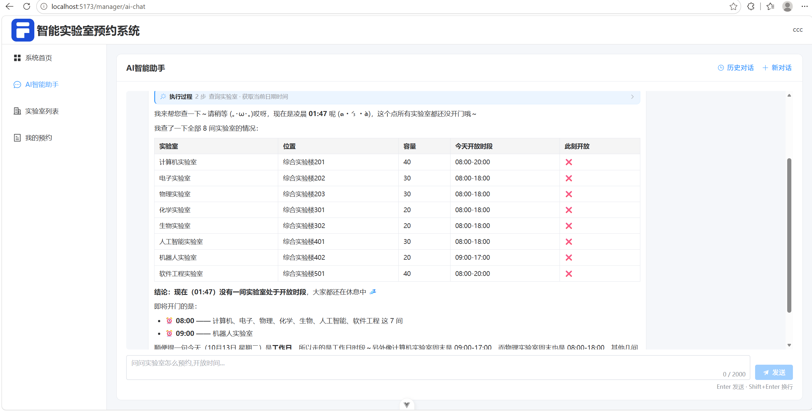
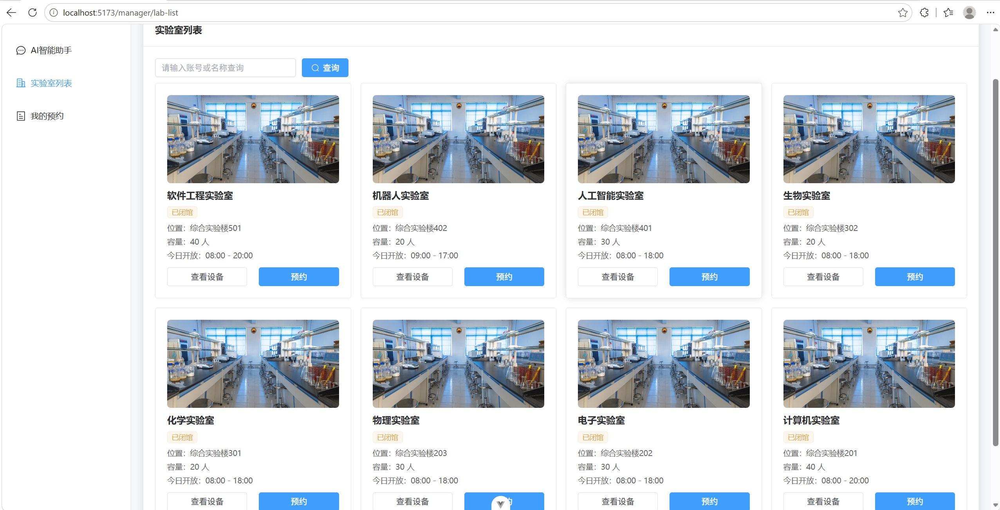
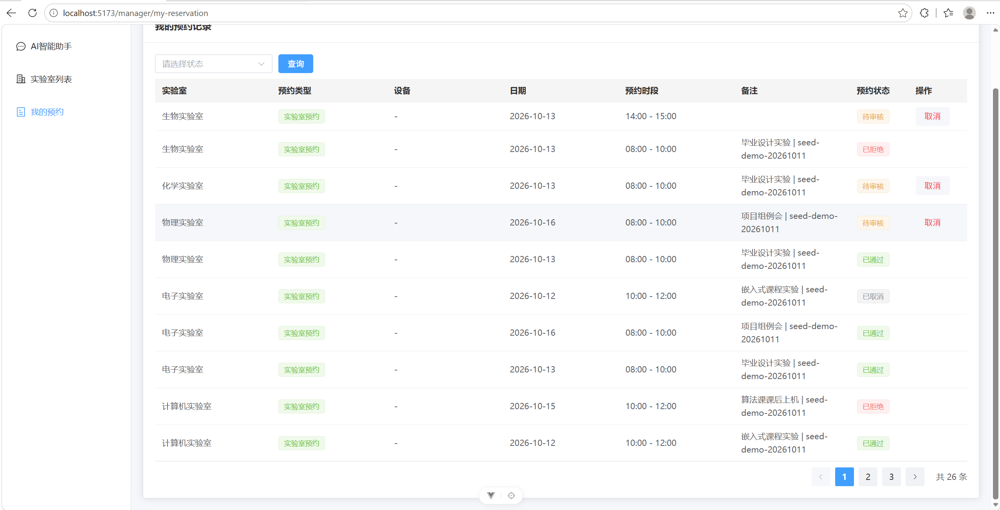
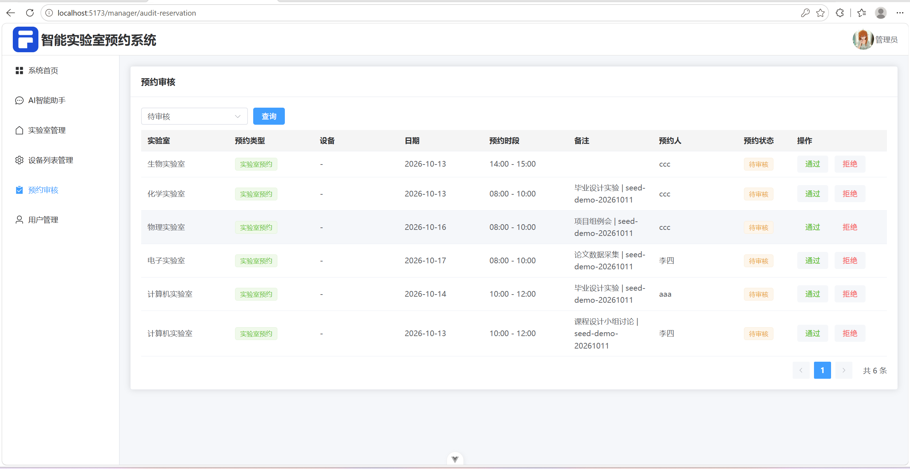

# 智能实验室预约系统

> A lab and equipment booking system with an LLM assistant that queries the database and places bookings on the user's behalf.

学生预约实验室、借用设备，管理员维护基础数据、审核预约。站内带一个 AI 助手（叫「小田」），它能真的去查空闲时段、查设备、替用户下单，而不是只会闲聊。

**仓库里没有任何演示账号和密码。** 想跑起来请自己注册一个——`scripts/init-demo.sh` 会引导你注册，密码当场由你输入，不进仓库。

---

## 功能

**学生**

- 注册 / 登录（JWT），改资料、改密码
- 按关键词搜实验室、看设备清单
- 预约实验室：选日期和时段，时间冲突会被拦下
- 借用设备：和实验室预约是两套独立资源，互不占用、互不阻塞
- 我的预约：查看、取消（只有待审核的能取消）。待审核的预约过了时段还没人审核，后台每 60 秒扫一次，自动置为已取消；已通过、已拒绝的不在这个扫描范围里
- AI 助手：查规章制度、查某天某实验室的空闲时段、查设备，也能直接下单；对话历史存在后端，换台设备登录还能接着聊

**管理员**

- 实验室、设备的增删改查
- 审核预约
- 用户管理，含**重置他人密码**（不需要知道对方原密码；重置后那个人所有设备立刻掉线）

## 技术栈

| 层 | 用了什么 |
| --- | --- |
| 前端 | Vue 3（`<script setup>`）、Vite、Pinia、Vue Router、Element Plus、ECharts、axios、marked + DOMPurify |
| 后端 | FastAPI、SQLAlchemy 2.0、Pydantic v2、PyMySQL |
| 数据库 | MySQL；表结构由 Alembic 管（迁移在 `backend/migrations/`，服务启动时自动升到最新）。实验室开放时间分周中、周末两档，同一天用哪档由 `lab_service.resolve_open_hours` 一处判定 |
| 鉴权 | JWT（PyJWT）+ bcrypt |
| AI | LangGraph 编排工具调用、langchain-openai / langchain-core、ChromaDB + sentence-transformers + `BAAI/bge-small-zh-v1.5` 做本地向量检索 |
| 限流 | slowapi |

---

## 跑起来

两条路。**只想看看界面长什么样**走第一条，本机不用装 Python、Node、MySQL。**要改代码**走后面，本机跑开发服务，有热重载和断点。

### 用 Docker 起全套

```bash
copy .env.example .env          # macOS / Linux: cp .env.example .env
```

打开刚生成的根目录 `.env`，把这五个填上：

| 变量 | 填什么 |
| --- | --- |
| `MYSQL_ROOT_PASSWORD` | 随便定一个，只给这个容器用 |
| `JWT_SECRET_KEY` | `python -c "import secrets; print(secrets.token_urlsafe(48))"` |
| `LLM_API_KEY` / `LLM_MODEL` / `LLM_BASE_URL` | 任何 OpenAI 兼容接口，要有 `/chat/completions` |

`TZ`、`CORS_ORIGINS`、`JWT_EXPIRE_HOURS` 都有默认值，不用动。这五个少一个，`docker compose up` 会**直接报错退出**，不会拿空值硬起——`JWT_SECRET_KEY` 照抄 `.env.example` 里的示例值也一样起不来（后端的启动自检会拒绝）。

```bash
docker compose up -d
```

第一次要下基础镜像和一批 Python 依赖。装完 `site-packages` 是 1.8G，其中 CPU 版 torch 自己就占 773M，后端镜像最终 2.6G，慢是正常的。（torch 要是不单独装 CPU 版，pip 会把 CUDA 版一起拽下来，再白多两个多 G。）

> 起来之后是**空库**：表由后端启动时自动建，但一条数据都没有。界面能开，登录不进去。

灌演示数据、顺手注册一个账号：

```bash
bash scripts/init-demo.sh --username 你的账号名 --admin
```

> ⚠️ Windows 上请在 **Git Bash** 里跑这条命令。PowerShell 里的 `bash` 不是 Git Bash（是 WSL 的壳）。

它会问密码（输入不回显，也不留在 shell 历史里），然后灌 8 间实验室 + 32 台设备、注册这个账号、把它提成管理员、再造 30 条演示预约，最后以四张表的行数收尾。

账号密码**必须由你自己传**：仓库是公开的，脚本里带任何默认凭据都等于公开一份。想用中文账号名就直接在 http://localhost:8080/register 上注册（脚本只放行字母数字下划线点减号——它要把这个名字拼进 SQL）。

打开 **http://localhost:8080** 登录。

#### 几个需要知道的

- **端口**：`8080` 前端（所有网卡都能连）；`8001` 后端直连，只绑 `127.0.0.1`，用来 `curl` 看原始响应；`3307` MySQL，只绑 `127.0.0.1`，Navicat 连这个（3306 留给本机自己的 MySQL）。
- **前端容器里的 nginx 自己反代** `/api` 和 `/uploads`，浏览器这边是同源的，所以 `CORS_ORIGINS` 留空是对的。
- **数据在卷里**：`mysql-data`（数据库）和 `uploads`（用户上传的文件）。`docker compose down` 不丢，`down -v` 才清空。
- **知识库索引没挂卷**，容器重建就会重做一遍。第一次要下 92MB 的 embedding 模型，缓存在仓库根的 `./.hf-cache/`（这个目录会保留，不会重复下）。
- **改了代码要重新构建**：`docker compose up -d --build`。跟日志：`docker compose logs -f backend`。
- **后端是单进程跑的**（没开 `--workers`）：限流计数器、知识库重建锁都在进程内存里，多开就各算各的。
- **容器用哪个时区由 `TZ` 决定**，默认 `Asia/Shanghai`。填错的话 AI 答"现在有哪些实验室开放"会整体偏八小时，界面上还看不出来。

想在本机改代码，接着往下看。

### 后端

需要 Python 3.11（开发时用的 3.11.9，仓库里没有声明最低版本）、Node 22.18+ 或 24.12+（见 `frontend/package.json` 的 `engines`）、MySQL（开发时用的 9.7.2，仓库里同样没有固定版本）。

```bash
cd backend
python -m venv .venv
.venv\Scripts\activate                 # macOS / Linux: source .venv/bin/activate
pip install -r requirements.txt
copy .env.example .env                 # macOS / Linux: cp .env.example .env
```

先建库：

```sql
CREATE DATABASE lab_agent DEFAULT CHARSET utf8mb4;
```

然后把 `backend/.env` 填好：

| 变量 | 说明 |
| --- | --- |
| `DATABASE_URL` | `mysql+pymysql://用户名:密码@127.0.0.1:3306/lab_agent?charset=utf8mb4` |
| `JWT_SECRET_KEY` | 至少 32 位随机串：`python -c "import secrets; print(secrets.token_urlsafe(48))"`。填成示例值后端会拒绝启动 |
| `LLM_API_KEY` / `LLM_MODEL` / `LLM_BASE_URL` | 任何 OpenAI 兼容接口，需要有 `/chat/completions` |
| `JWT_EXPIRE_HOURS` / `JWT_ALGORITHM` | 默认 24 小时 / HS256，可以不填 |
| `CORS_ORIGINS` | 逗号分隔，本机开发用默认值就行 |

上面五个没有默认值（`DATABASE_URL`、`JWT_SECRET_KEY` 和那三个 LLM 变量），**少一个后端就起不来**——配置是在 import 时就校验的。没有可用的 OpenAI 兼容接口就没法启动，AI 助手不是可选项。

启动，表会自动建出来：

```bash
.venv\Scripts\python -m uvicorn app.main:app --reload
```

> 上面这种 `.venv\Scripts\python` 是 Windows 写法，本节和后面「测试」一节里的命令都是这样。macOS / Linux 上把它换成 `.venv/bin/python`，或者先 `source .venv/bin/activate`，之后直接用裸 `python` 就行。

服务在 `http://127.0.0.1:8000`，接口文档在 `/docs`。

> 第一次启动会去 HuggingFace 下载知识库用的 embedding 模型 `BAAI/bge-small-zh-v1.5`（约 90MB）并建索引。这一步虽然丢在独立线程里跑（不占事件循环），但**启动流程会一直等它跑完**——模型没下完之前端口是不通的，第一次启动别以为卡死了。真失败了也只会在控制台打一段 traceback，**后端照样启动**，代价是 AI 查不到知识库内容。国内网络可以设 `HF_ENDPOINT=https://hf-mirror.com` 走镜像。

空库跑起来没什么可看的，想灌点数据，顺序不能反：

```bash
# 1. 实验室和设备。在 Navicat 之类的工具里整段执行 backend/demo_data.sql
#    ⚠️ 会先清空 labs / equipments 两张表，不可撤销

# 2. 注册一个账号（脚本刻意不建用户——公开仓库里硬编码账号会变成公开的默认凭据）

# 3. 演示用的预约记录。库里没有实验室、或者一个用户都没有，它会直接中止
.venv\Scripts\python scripts/seed_demo_data.py           # 默认只预演、不写库
.venv\Scripts\python scripts/seed_demo_data.py --apply   # 确认无误再加
```

### 前端

```bash
cd frontend
npm install
npm run dev            # http://localhost:5173
```

前端请求打到哪儿，有两种情况：

- 仓库里**没有** `frontend/.env.development`（它被 `.gitignore` 忽略了）。不建这个文件时 `VITE_API_BASE_URL` 是空的，请求发到同源的 5173，由 `vite.config.js` 里的代理把 `/api`、`/uploads` 转发给 `127.0.0.1:8000`。
- 自己建一个 `frontend/.env.development` 写上 `VITE_API_BASE_URL=http://127.0.0.1:8000`，请求就直接打到后端。

两种都要求后端先起来。

打包：`npm run build`，产物在 `frontend/dist`。

> 部署建议让前后端同域：nginx 把 `/api` 反代给后端，静态文件交给 `frontend/dist`。这样浏览器不发跨域请求，`CORS_ORIGINS` 只在前后端分开跑时才有用。
> 这套方案已经落在 `frontend/nginx.conf` 里了（Docker 起前端用的就是它），手动部署可以照抄。
> （顺带一提，也可以让 FastAPI 直接挂载 `dist`，但现在的 `main.py` 只挂载了 `/uploads`，还没做这件事。）

---

## 测试

```bash
cd backend
.venv\Scripts\python -m pytest
```

跑之前要**另建一个空库**，`conftest.py` 只会建表、不会建库：

```sql
CREATE DATABASE lab_agent_test DEFAULT CHARSET utf8mb4;
```

`conftest.py` 会把 `.env` 里的库名强行改成 `lab_agent_test`，所以不用你去配。它有两道保险丝，防的是「测试把开发库清了」这件事：一道查改完之后的库名，另一道**直接查 `engine` 真正连上的库**——上一次出事故就是因为某个 pytest 插件在 `conftest` 之前就 import 了 `app`，导致环境变量覆盖没生效，改动被静默吞掉。所以第二道才是真正兜住的那道。

前端跑 vitest（不需要起后端、不需要数据库）：

```bash
cd frontend
npm test          # vitest run，跑完就退出
npm run test:watch   # 开发时盯着改
```

覆盖 `src/utils/auth.js`、`src/utils/request.js`、`src/stores/user.js` 三个模块——都是纯逻辑，用 `happy-dom` 提供的 `localStorage` 就够，不渲染任何组件、不加载 Element Plus，所以跑一遍不到 1 秒。重点守的是三处真实踩过的坑：登出必须同时清掉内存里的用户信息（只清 localStorage 的话侧边栏要刷新才消失）、401 只弹一条提示、`saveLoginData` 不能漏掉 `setToken`。

另外还有构建验证：`cd frontend && npx vite build`。

CI（GitHub Actions）跑的就是上面这些，前后端各一个 job。后端那个用真的 MySQL 服务容器而不是 SQLite——这套代码用到行锁（`test_concurrency` 那组用例），SQLite 没有，测出来的绿是假的；跑完会把 pytest 的最后一行汇总写进 job 摘要（`$GITHUB_STEP_SUMMARY`）。前端那个跑 `npm ci` + `npm test` + `npm run build`。

> 前端测试用**变异检验**证明过有效：把上面那三处逻辑逐一改坏（logout 不清内存、前缀判据换成 `includes`、`isAdmin` 写成「非 student 即管理员」、漏掉 `setToken`、401 只清 localStorage、401 弹两条 toast），六个变体全部被对应用例抓红。跑通不算数，**改坏了会红**才算数。

## 目录结构

```
backend/
  app/
    api/           路由层，多数接口只做参数校验和转发（文件上传、AI
                   流式对话这两个是在层内自己处理的）
    services/      业务逻辑都在这里
    models/        SQLAlchemy 模型
    schemas/       Pydantic 出入参
    common/        统一响应体和异常处理
    dependencies/  登录态、管理员校验
  migrations/      Alembic 迁移，表结构的每一次变更都落在这里
  tests/           228 条用例
  demo_data.sql    实验室 / 设备基础数据
  scripts/         演示预约数据生成
  Dockerfile
frontend/
  src/
    views/         15 个页面
    api/           按后端模块分的请求封装
    components/    BaseChart 等复用组件
    stores/        Pinia
    utils/         请求封装、登录态读写（旁边的 __tests__/ 是 vitest 用例）
  vitest.config.js 前端测试配置
  Dockerfile       node 构建 → nginx 托管
  nginx.conf       静态文件 + 反代 /api、/uploads
scripts/
  init-demo.sh     一键初始化：灌数据 + 注册账号 + 造演示预约
docs/              图标和界面截图
docker-compose.yml MySQL + 后端 + 前端
```

---

## 几处实现细节

**并发预约用 MySQL 命名锁。** 两个人同一秒抢同一个时段，光靠「先查有没有冲突、再写入」会双双通过。这里用 `GET_LOCK` 把「检查冲突 + 写入」锁成一个原子段。实验室和设备是两套独立资源，各锁各的，互不阻塞——这是有意设计，不是漏加锁。

**AI 一轮里并发调多个工具时，每个工具各开一个数据库会话。** LangGraph 的 `ToolNode` 用 `asyncio.gather` 并发跑同一轮的工具调用，同步工具会被丢进各自的线程。它们要是共用一个 SQLAlchemy `Session`，SQLAlchemy 会直接拒绝：`This session is provisioning a new connection; concurrent operations are not permitted`。更麻烦的是会话被弄坏之后，这一轮剩下的查询会全部跟着失败，用户看到的就是「这个功能坏了」。改成每个工具自己 `with SessionLocal() as db` 之后，实测 8 个并发查询从 7 个失败变成全部成功。`tests/test_concurrency.py` 里有这条回归用例。

**AI 的回答是流式的，而且中途断线不丢内容。** 后端用 SSE 边生成边推，前端手写 `fetch` + `ReadableStream` 解析（全站只有这一处没走 axios）。用户关掉网页的那一刻，生成器会被取消——抛的是 `CancelledError`，它不属于 `Exception`，兜底的 `except Exception` 拦不住。所以「把这一轮存进数据库」放在 `finally` 里，用户的提问则在开始吐字之前就落库。关掉标签页再打开，这一轮对话还在。

**给 AI 查的知识库是本地向量检索。** `backend/data/kb/` 下 4 份 Markdown（开放时间、预约规则、设备使用、安全规范）用 ChromaDB 建索引，embedding 模型在本地跑，不用调外部接口——但**第一次要能从 HuggingFace 把模型下下来**。向量库本身不进仓库（`backend/data/chroma/` 被忽略），所以新克隆的仓库没有现成索引。

**embedding 模型只认本地缓存，装载时不再联网。** 加载时传的是 `local_files_only=True`。这个联网检查在国内网络下代价极大：`huggingface_hub` 每次装载都要 `HEAD` 一次 huggingface.co 取 commit hash，而国内连 TCP 都建不起来，要卡满 21 秒（`WinError 10060`）才放弃，而且还要重试 5 次。实测同一个模型：联网检查要 **308 秒**，不联网只要 **5.6 秒**。这笔时间全落在启动上，而 uvicorn 的监听端口是等 lifespan 跑完才建的——启动期间前端发什么都连不上。所以「热重载太慢」和「老是连接失败」是同一个病，不是两件事。

本地缓存里没有这个模型时（新克隆的仓库第一次启动就是这样），会自动退回联网那条路去下载，只慢这一次。

想换模型版本，把缓存目录改名或删掉即可，下次启动会重新下载：`~/.cache/huggingface/hub/models--BAAI--bge-small-zh-v1.5`（Windows 上是 `C:\Users\<用户名>\.cache\huggingface\hub\` 下的同名目录）。**但换完必须手工删掉 `backend/data/chroma/`**：索引指纹只看 `data/kb/` 里 md 的文件名和内容，认不出模型换了，不删就会继续拿旧向量用——新旧向量不在同一个空间里，检索不会报错，只会悄悄变差。

**其中「开放时间.md」是生成的，不要手改。** 后端启动时、以及管理员在管理端增删改实验室之后，都会按 `labs` 表把它重画一遍（文件头也写了这句），手改会在下一次被覆盖。想调开放时间请走管理端的「实验室管理」——那边改完，知识库、AI 工具、界面三处是同一个来源，不会各说各话。

**改了 md 不用再手工删向量库。** 索引靠一份内容指纹判断新旧：文件内容变了，下一次 AI 检索时就地 `upsert` 增量重建（不是先删后建，中途失败老索引还在，指纹也只在重建成功后才写，失败了下次会重试）。整个重建过程不占管理端请求线程，也不占启动流程。

**错误响应分两套，不是全 200。** 业务异常走 HTTP 200，状态放在 body 的 `code` 里；但鉴权失败是真的 HTTP 401，参数校验失败 422，触发限流 429。前端拦截器两条路各判一次 401（一条看 body 里的 `code`，一条看 HTTP 状态码），都会登出、跳登录页，并把后端那句原因提示出来。

**改密码会把这个人所有设备踢下线。** 每张令牌里带着签发那一刻的令牌版本号（`users.token_version`），改密码时版本号 +1，旧令牌下一个请求就在 `dependencies/auth.py` 里对不上号被拒。这个比对不额外查库——鉴权本来每个请求就要查一次用户。注意"立刻失效"的准确含义是**下一个请求即失效**，没有推送通道，纯打开的标签页要等它下次发请求才会被踢。管理员重置他人密码（`PUT /api/user/{id}/password`）走的是同一套：重置同样 +1，否则"号被盗了"这个场景下重置等于没做。

**密码的长度边界是 3 ~ 72 字节，注意是字节。** 上限不是我们的规定，是 bcrypt 的规定：bcrypt 5.0 碰到超过 72 字节的输入**直接抛异常**，不是老版本那种静默截断，不拦就是 HTTP 500。而一个汉字在 UTF-8 里占 3 字节，所以 24 个汉字就到顶了——按字符数卡会漏掉所有中文密码。下限只在"设置新密码"时管（注册、新建用户、改密码、重置密码四处共用一份规则），**登录那条路刻意不卡下限**：库里存着当年没卡过长度时注册的短密码，卡了等于把人锁在门外，而且报的错还跟密码对不对毫无关系。

## 已知限制

- **限流是内存计数器，只在单进程下准。** uvicorn 开多 worker 时每个进程各算各的，实际额度翻倍；要精确得换 Redis。
- **下线是"一锅端"，踢不了单独某一台设备。** 改密码让该用户**全部**旧令牌失效，做不到"只踢被盗的那一台、保留其他设备"。要精确到单枚令牌得引入会话表，那是另一件事。
- **登出只清浏览器，不通知后端。** 没有 logout 接口，退出登录就是删掉本地令牌，那枚令牌在过期前（默认 24 小时）仍然有效。想让它立刻作废只能改密码。
- **迁移在服务启动时执行，假设单进程。** uvicorn 开多 worker 时每个进程都会跑一遍，并发 DDL 会撞车；要让多 worker 同时启动，得把 `run_migrations()` 从 lifespan 挪到部署流程里单独执行，或者用 MySQL 的 `GET_LOCK` 包一层（`reservation_service` 里已有现成用法）。
- **关掉标签页后，这一轮回答会停在那里。** 内容不会丢（`finally` 里落了库），但后端不会接着写完，重新打开看到的是半截。已计划改成后台任务继续生成。
- **对话历史每人最多留 50 个会话**（按会话裁，不是按消息条数），超了删最旧的。
- 没有 pre-commit 钩子。（CI 和 Docker 都补上了：前者是 GitHub Actions 跑前后端各一个 job，后者见上面「跑起来」。）

## 界面









## 仓库里的素材

- `素材/实验室.jpg` 是早期找的示意图，代码里没有任何地方引用。
- 仓库暂未指定开源许可。
